

  

 


  


  <a href="https://github.com/milofrio066/nextONE"></a>
  <a href="https://github.com/milofrio066/Airlock"></a>

  <a href="https://raiz-jet.vercel.app/"></a>
  <a href="https://github.com/milofrio066/Consumo-Energ-tico-en-Zonas-no-Interconectadas-de-Colombia"></a>

  
  
  

 


  


  


  


  

  

  <picture>
    <source media="(prefers-color-scheme: dark)" srcset="https://raw.githubusercontent.com/milofrio066/milofrio066/output/github-snake-dark.svg" />
    
  </picture>

 


  
  
  

